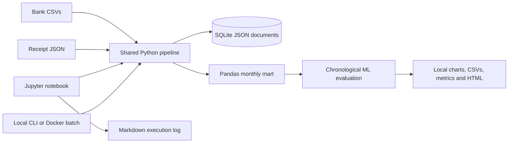

# Personal Finance Tracker

A local, notebook-first bachelor's data science project: five years of synthetic
bank transactions, CSV/JSON preprocessing, SQLite document storage, exploratory
analysis, expense categorization, anomaly review, forecasting, and exportable reports.

**Recommended demo:** run Jupyter with Python locally. Use Docker Compose when you
want the same notebook and batch workflow without installing Python on another machine.
No external account, credentials, paid service, GPU, or dataset download is required.

## Run with Python

Use **Python 3.14**, the verified runtime for the pinned dependency snapshot. The package
declares Python 3.11+ support through dependency resolution, but other versions are not
verified here. Run commands from this repository's root.

When upgrading an older environment, prefer creating a fresh virtual environment.
Reinstalling a smaller dependency set does not uninstall previously installed extras;
the current package and dependency snapshot no longer require those old libraries.

Windows PowerShell:

```powershell
py -3.14 -m venv .venv
.\.venv\Scripts\python.exe -m pip install -c requirements-lock.txt -e ".[dev]"
.\.venv\Scripts\python.exe -m jupyterlab notebooks/finance_demo.ipynb
```

macOS/Linux:

```bash
python3.14 -m venv .venv
.venv/bin/python -m pip install -c requirements-lock.txt -e '.[dev]'
.venv/bin/python -m jupyterlab notebooks/finance_demo.ipynb
```

Open the localhost URL printed by Jupyter and select **Restart Kernel and Run All Cells**.
For VS Code, open [notebooks/finance_demo.ipynb](notebooks/finance_demo.ipynb), select
the `.venv` kernel, and run all cells. Keep Jupyter authentication enabled and do not
share the server token. Initial package installation needs Internet; the installed
synthetic-data demonstration does not access external services.

## Run with Docker

Install Docker with Compose v2 and use Linux containers. Create writable input/output
directories first. Windows PowerShell:

```powershell
New-Item -ItemType Directory -Force data, outputs
docker compose up --build notebook
```

Linux/macOS shell (use the host user's IDs for writable bind mounts):

```bash
mkdir -p data outputs
export LOCAL_UID=$(id -u)
export LOCAL_GID=$(id -g)
docker compose up --build notebook
```

Open `http://localhost:8888` using the token shown in the container log. The notebook
is available under `notebooks/finance_demo.ipynb`. Input data, reports, and notebook
edits persist on your host. See [docs/DOCKER.md](docs/DOCKER.md) for batch runs,
HTML export, alternate ports, file permissions, and cleanup.

## Batch Processing and Verification

After activating the virtual environment:

```bash
finance-demo --generate-demo
python -m pytest -q -W error
python scripts/execute_notebook.py
```

Without activation, use the environment's Python path and
`python -m finance_tracker.pipeline --generate-demo`. Container equivalents:

```bash
docker compose run --rm batch
docker compose run --rm batch python scripts/execute_notebook.py
```

Do not run batch and notebook processing simultaneously against the same output directory.
The notebook runner exports `outputs/finance_demo.executed.ipynb` and
`outputs/finance_demo.html`. Charts and tables work in HTML; live widgets need a kernel.

## Local Architecture



| Responsibility | Implementation |
| --- | --- |
| Input landing area | Local `data/` CSV and JSON files |
| Transaction documents and receipts | `outputs/transactions.sqlite3` with stable-ID upserts |
| Analytical mart | Pandas aggregations and `outputs/monthly.csv` |
| Repeatable processing | Shared `finance-demo` command or Docker batch service |
| Presentation | JupyterLab or VS Code notebook, optionally inside Docker |
| Observability | Console output, metrics JSON, and notebook activity Markdown |
| Automation | Explicit batch runs; optional operating-system scheduling |

## Outputs and Study Design

The default seeded dataset has 4,320 valid transactions plus intentional missing values,
duplicates, and an invalid date. Generated inputs and outputs are excluded from Git.

- `metrics.json`: cleaning audit, chronological holdout metrics, and baselines.
- `categorized_transactions.csv`: recorded labels, predictions, and effective labels.
- `monthly.csv`: income, spending, net cash flow, savings rate, and cumulative cash flow.
- `forecast.csv` and `forecast_backtest.csv`: estimates and rolling evaluation.
- `anomalies.csv`: review flags, scores, and holdout membership.
- `overview.png`: exportable chart overview.
- `transactions.sqlite3`: local JSON documents and nested receipts.
- `notebook_activities.md`: timestamped processing explanations and observed results.

Classification uses TF-IDF and scaled expense with Logistic Regression, chronological
holdout macro F1, and a majority baseline. Isolation Forest provides anomaly review.
Ridge forecasting uses lagged spending, a rolling MAE evaluation, and a seasonal-naive
baseline. Year/category filters and budget scenarios are interactive in the notebook.

Synthetic repeated merchants make classification easier than real life. Anomaly flags
are not fraud determinations; forecast bands are heuristic. Pandas is in-memory and
SQLite is not distributed NoSQL. The project does not claim production scale or provide
financial advice. See [Abstract.md](Abstract.md) for the revised assessed scope.

## Guides

- [docs/presentation/README.md](docs/presentation/README.md): editable project presentation
    in PowerPoint, Word, and Markdown, with identity placeholders and actual notebook charts.
- [docs/DEMO.md](docs/DEMO.md): viva sequence, input schema, privacy, and limitations.
- [docs/DOCKER.md](docs/DOCKER.md): local container setup and operations.
- [ACTIVITIES.md](ACTIVITIES.md): ongoing implementation/setup explanation log.
- [config/demo.json](config/demo.json): seed, data years, currency, and forecast horizon.
- [future-cloud-scope/README.md](future-cloud-scope/README.md): inactive future material,
  excluded from the package, tests, active CI, and container context.

The original supplied abstract and prior implementation history are retained in that
archive. Only this local Python/Jupyter/Docker workflow is currently supported.