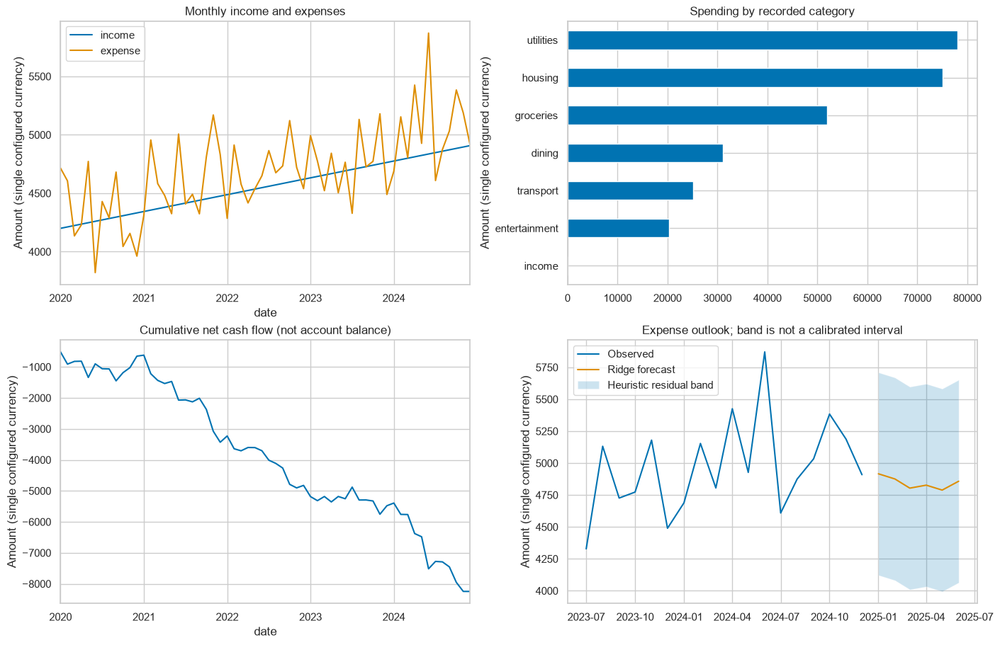
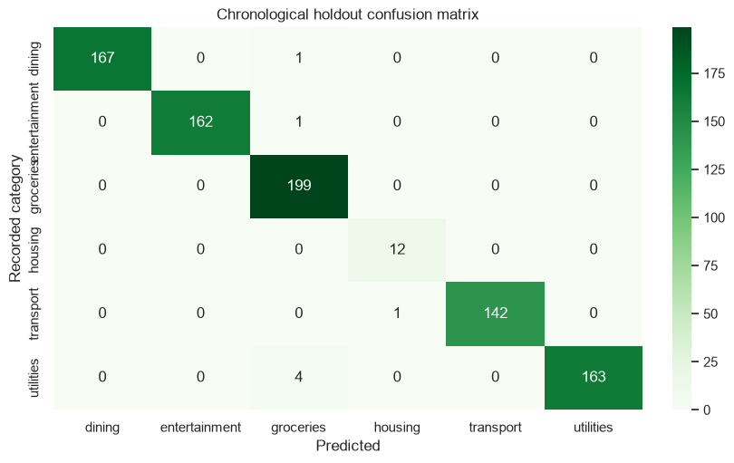
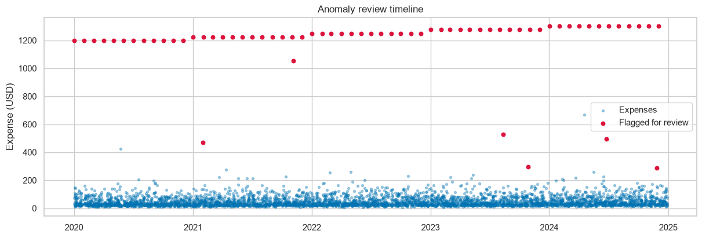
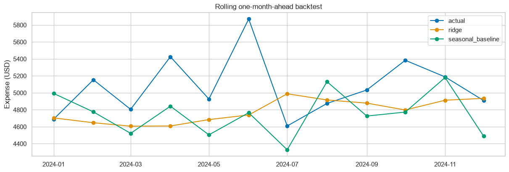

# Personal Finance Tracker and Predictive Visualizer

A Local, Notebook-First Data Science Project

---

## Slide 1: Personal Finance Tracker and Predictive Visualizer

- Bachelor's Project Presentation
- Presented by: [STUDENT NAME(S)]
- Register / Roll number(s): [REGISTER / ROLL NUMBER(S)]
- Programme / Department: [PROGRAMME AND DEPARTMENT]
- Project guide: [GUIDE NAME AND DESIGNATION]
- Institution / University: [INSTITUTION AND UNIVERSITY]
- Academic year / Date: [ACADEMIC YEAR] / [PRESENTATION DATE]

**Note:** [INSTITUTION LOGO PLACEHOLDER]

**Presenter Notes:** Introduce the team and guide. State that the primary deliverable is a working local Jupyter notebook, not a hosted financial application. Replace bracketed fields before presenting.

---

## Slide 2: Abstract and Project Overview

- A reproducible workflow turns multi-year bank CSVs and receipt JSON into financial insights.
- Python cleans records, stores transaction documents, and builds monthly analytical summaries.
- Machine learning supports expense categorization, anomaly review, and expense forecasting.
- Jupyter combines experiments, visualizations, evaluation, and interactive budget scenarios.
- The assessed demonstration runs locally; Docker is an optional packaging alternative.

**Note:** Educational analytics using synthetic data; not financial advice.

**Presenter Notes:** Explain the complete sequence: ingest, clean, store, aggregate, model, visualize, and reproduce. Emphasize that the project can be demonstrated without external accounts or paid infrastructure.

---

## Slide 3: Problem Statement

- Bank exports spread transactions across files, time periods, and inconsistent records.
- Manual spreadsheet review makes multi-year spending patterns difficult to compare consistently.
- Missing descriptions, duplicate IDs, and invalid dates can distort summaries.
- Categorization, unusual spending, and future budgets need an auditable analytical workflow.
- Research question: can a notebook provide useful insight while making model limitations visible?

**Note:** The comparison is with manual analysis, not a benchmark against commercial finance products.

**Presenter Notes:** Frame these as motivations and design requirements. Do not claim that every existing application lacks these capabilities; no commercial-product comparison study was performed.

---

## Slide 4: Objectives

- Ingest full-history bank CSVs and enrich matching transactions with JSON receipts.
- Audit and preprocess missing, invalid, duplicate, and inconsistent records.
- Build local transaction documents and monthly cash-flow marts.
- Evaluate categorization, anomaly review, and forecasting using time-ordered experiments.
- Deliver interactive notebook analysis, reports, tests, and portable setup instructions.

**Note:** Each objective is demonstrated through the shared Python implementation.

**Presenter Notes:** Point to ingestion, SQLite, analytical marts, model evaluation, and the notebook as tangible outputs rather than promising enterprise-scale infrastructure.

---

## Slide 5: Scope and Deliverables

- One configured currency and a full-history dataset; positive amounts mean income and negative amounts mean spending.
- A seeded five-year dataset supports repeatable demonstrations without exposing private bank records.
- Deliverables: notebook, reusable Python package, CLI, tests, metrics, CSVs, charts, and HTML report.
- SQLite JSON and Pandas provide local storage and analytics; no remote services are required.
- Excluded: live bank connectors, currency conversion, fraud decisions, and production accounting guarantees.

**Note:** At least 36 complete monthly periods are required by the full forecasting workflow.

**Presenter Notes:** Distinguish repeatable local processing from distributed big-data processing. Explain why controlled scope makes the bachelor's demonstration reliable.

---

## Slide 6: Technology and Execution Requirements

- Python 3.14: the verified runtime and dependency snapshot.
- JupyterLab, IPython, and ipywidgets: narrative, execution, and interactive controls.
- Pandas and NumPy: preprocessing, aggregation, and numerical features.
- scikit-learn: Logistic Regression, Isolation Forest, Ridge, and evaluation metrics.
- Matplotlib / Seaborn and SQLite: visual reporting and local JSON document persistence.
- Optional Docker Compose: notebook and batch services using the same local code.

**Note:** Initial dependency installation needs Internet; the installed synthetic-data workflow does not.

**Presenter Notes:** The directly verified environment is Windows with Python 3.14. Other OS CI jobs are defined, not claimed as already executed. Docker is optional and was unavailable during implementation verification.

---

## Slide 7: System Architecture and Data Flow

- Bank CSV + receipt JSON -> validation and preprocessing
- Clean transactions -> SQLite JSON documents and monthly Pandas mart
- Analytical mart + transaction features -> time-ordered machine-learning experiments
- Results -> Jupyter charts, filters, budget scenarios, and local reports
- Notebook, CLI, and Docker batch share one Python pipeline

**Note:** Local data/ and outputs/ directories remain on the host when using Docker bind mounts.

**Presenter Notes:** Trace one transaction from bank input to receipt enrichment, local persistence, aggregation, and model evaluation. There is no second implementation for the CLI or container.

---

## Slide 8: Dataset and Data Dictionary

- Synthetic calendar: January 2020 to December 2024; seed 42.
- Raw data deliberately includes quality problems to make preprocessing observable.

| Field | Role |
| --- | --- |
| transaction_id | Globally unique transaction key |
| date / description | Timestamp and merchant text |
| amount / currency | Signed amount and single-currency validation |
| category | Recorded label for supervised evaluation |
| receipt / anomaly label | Nested enrichment / synthetic evaluation only |

**Note:** Synthetic anomaly labels are never used as model features.

**Presenter Notes:** Recorded category labels are needed in the historical training period. Unknown labels can be inferred later. Globally unique IDs avoid collisions when combining exports.

---

## Slide 9: Preprocessing and Data-Quality Audit

- Normalize timestamps to UTC, validate amounts and currency, remove duplicate IDs, and fill missing merchant descriptions.
- Conflicting dates or amounts under one ID and mixed currencies are rejected explicitly.

| Audit measure | Observed value |
| --- | --- |
| Raw input rows | 4,333 |
| Invalid rows rejected | 1 |
| Duplicate transaction IDs removed | 12 |
| Missing descriptions filled | 43 |
| Clean transactions / matched receipt | 4,320 / 1 |

**Note:** A receipt enriches an existing bank transaction; it does not create another expense.

**Presenter Notes:** The row audit reconciles as 4,333 minus 1 invalid row minus 12 duplicate rows equals 4,320. Missing descriptions are filled, not deleted.

---

## Slide 10: Exploratory Analysis and Cash Flow

- Inspect monthly income, expenses, category totals, and cumulative net cash flow.
- Reconcile monthly net cash flow with the sum of transaction amounts.
- Use the overview and category heatmap to discuss trends and unusual periods.

Generated overview from the executed synthetic-data notebook.

**Note:** Cumulative net cash flow is not an account balance: the opening balance is unknown.

**Presenter Notes:** The financial data is synthetic. Refer to visible patterns rather than claiming behavior of a real individual. The separate heatmap in the notebook supports category-by-month analysis.

---

## Slide 11: Expense Categorization

- Features: TF-IDF merchant text and standardized expense amount.
- Model: Logistic Regression with preprocessing fitted only on the earlier training period.
- Chronological holdout: 3,408 training expenses and 852 later test expenses.
- Macro F1: 0.9872 versus majority baseline 0.0549.

Confusion matrix for the later-period classification holdout.

**Note:** No unseen merchant descriptions occur in this holdout; the result does not establish new-merchant accuracy.

**Presenter Notes:** Macro F1 averages performance across categories; it is not accuracy. Synthetic merchant repetition makes this experiment relatively easy. A stronger study would include merchant-disjoint evaluation and reviewed real labels.

---

## Slide 12: Unsupervised Anomaly Review

- Isolation Forest fits earlier log-expense and day-of-month features without anomaly labels.
- Synthetic labels evaluate only later transactions; 66 transactions are flagged overall.
- Holdout precision: 7.14%; recall: 33.33%, with only 3 injected holdout anomalies.
- Low precision means many flagged purchases are not injected anomalies.

Expense timeline with transactions flagged for review.

**Note:** A flag is a review candidate, not a fraud conclusion or a payment-blocking decision.

**Presenter Notes:** This is deliberately an honest weak result. A fixed contamination assumption does not estimate a real fraud rate. The small labelled holdout and synthetic injection process severely limit conclusions.

---

## Slide 13: Expense Forecasting and Backtesting

- Ridge features: previous month, three-month mean, last year's same month, and calendar seasonality.
- Refit chronologically for 12 one-month-ahead backtest predictions.
- MAE: 364.60 USD versus seasonal-naive baseline 413.31 USD.
- Generate six future months recursively from available history and predictions.

Rolling backtest: actual expense, Ridge prediction, and seasonal baseline.

**Note:** Lower MAE is better. The forecast band's residual shading is heuristic, not a calibrated interval.

**Presenter Notes:** The backtest observes actual history only after each prediction. Future recursive forecasts differ from one-step backtesting, and uncertainty may grow with horizon. The baseline improvement is specific to this synthetic sample.

---

## Slide 14: Interactive Notebook Demonstration

- Run all cells to generate fixtures, clean transactions, train models, and export results.
- Change year and category controls to inspect monthly spending.
- Adjust the budget-reduction slider to compare hypothetical expense and net cash flow.
- Inspect nested receipt JSON and monthly SQL summaries in SQLite.
- Open the CSV, PNG, HTML, and timestamped Markdown execution reports.

**Note:** Static exports preserve charts and tables; live widget interaction requires a running notebook kernel.

**Presenter Notes:** Suggested live order: audit, charts, confusion matrix, anomaly review, forecast comparison, filters, budget slider, and local storage. Keep the exported HTML as a fallback.

---

## Slide 15: Implementation Modules and Outputs

| Module / artifact | Responsibility |
| --- | --- |
| data.py | Fixtures, CSV/JSON ingestion, audit, SQLite upserts |
| analytics.py | Monthly mart, ML experiments, and charts |
| pipeline.py | Shared workflow and finance-demo CLI |
| finance_demo.ipynb | Narrative, results, filters, scenarios, and SQL inspection |
| outputs/ | Metrics, categorized CSV, forecast, anomalies, charts, SQLite, HTML |
| ACTIVITIES.md | Implementation/setup record; notebook also writes a runtime log |

**Note:** Generated data and reports are ignored by Git; portable code and generic configuration are versioned.

**Presenter Notes:** Show that business logic is reusable Python rather than copied across notebook cells and batch scripts. Notebook outputs may contain private data if users import bank records, so outputs must be cleared before sharing source.

---

## Slide 16: Testing and Reproducibility

- Six local tests pass with warnings treated as errors.
- Tests cover cleaning, currency/ID validation, upserts, inference, exports, chronology, and CLI scope.
- A forecast leakage test changes the final actual month and checks prior predictions remain unchanged.
- All six notebook code cells execute in a clean environment; five nonblank chart images were verified.
- Pinned dependencies, a fixed seed, and a shared pipeline support reproducibility on another machine.

**Note:** Docker configuration was checked, but Docker runtime and remote CI execution were not verified locally.

**Presenter Notes:** Distinguish implemented CI gates from observed passing runs. A separate clean installation ran without Google SDKs. The source notebook retains 12 cells with valid metadata and writes executed outputs to an ignored directory.

---

## Slide 17: Results Summary

| Experiment | Observed result | Interpretation |
| --- | --- | --- |
| Data quality | 4,333 raw -> 4,320 clean | Audit makes preprocessing visible |
| Category macro F1 | 0.9872 vs 0.0549 baseline | Strong on repeated synthetic merchants |
| Anomaly precision / recall | 7.14% / 33.33% | Weak precision; human review essential |
| Forecast MAE (USD) | 364.60 vs 413.31 baseline | Lower error on this synthetic backtest |
| Local tests / notebook | 6 passed / 6 code cells executed | Local workflow reproduced successfully |

**Note:** All scores refer to the seed-42 synthetic experiment, not validated real-bank performance.

**Presenter Notes:** Report each metric in its own units. Do not present F1 as accuracy or forecast MAE as a percentage. The anomaly finding is a limitation rather than evidence of fraud-detection success.

---

## Slide 18: Limitations, Privacy, and Ethics

- Synthetic data and repeated merchants limit generalization; anomaly ground truth is sparse and artificial.
- Pandas is in-memory and SQLite is local; distributed-scale performance has not been demonstrated.
- The pipeline is single-currency and needs complete history; transfers, refunds, and partial months need review.
- Forecast bands are uncalibrated, and cumulative cash flow is not a bank balance.
- Real datasets require consent, anonymization, label review, and careful control of notebook outputs.

**Note:** No investment recommendations, financial advice, or automatic fraud decisions are provided.

**Presenter Notes:** Explain why privacy-safe synthetic inputs are appropriate for a classroom demo. Local execution alone does not guarantee privacy if bank records or executed notebooks are later uploaded publicly.

---

## Slide 19: Future Work and Conclusion

- Evaluate consented, anonymized bank records with human-reviewed labels and merchant-disjoint splits.
- Improve anomaly review using richer context and more representative evaluation labels.
- Compare forecasting methods, evaluate multiple horizons, and calibrate uncertainty.
- Benchmark larger inputs before considering deferred infrastructure stored in future-cloud-scope/.
- Conclusion: the project delivers a transparent, executable local workflow from raw records to evaluated insights.

**Note:** The notebook is the central deliverable; future infrastructure is outside the current assessed scope.

**Presenter Notes:** Close by connecting the implemented objectives to the demonstration. Avoid promising that a more complex model or infrastructure change will necessarily improve outcomes.

---

## Slide 20: References and Questions

- Python documentation: https://docs.python.org/3/
- Pandas documentation: https://pandas.pydata.org/docs/
- scikit-learn User Guide: https://scikit-learn.org/stable/user_guide.html
- JupyterLab documentation: https://jupyterlab.readthedocs.io/en/stable/
- SQLite JSON functions: https://www.sqlite.org/json1.html
- Project repository: https://github.com/swasthika-aa/personal-finance-tracker

**Note:** Thank you. Questions and discussion.

**Presenter Notes:** These references document the tools used; they are not a fabricated literature review. Add institution-required citations or relevant peer-reviewed literature only after reading and verifying them.
