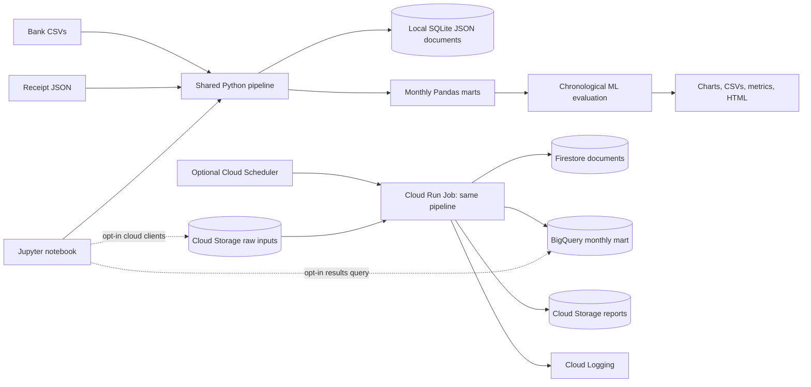

# Personal Finance Tracker

> Historical cloud-era project guide. Paths and commands describe the earlier layout,
> not the current local-only application. See the [archive status](../README.md).

A notebook-first bachelor's data science project implementing the workflow in
[Abstract.md](Abstract.md): multi-year transaction ingestion, preprocessing, document
storage, exploratory analysis, categorization, anomaly review, forecasting, and reporting.

## Recommended Demo

**Use local Python and Jupyter as the assessed demonstration.** Everything analytical
runs without GCP, Kaggle, Docker, GPUs, or downloaded datasets. A fixed-seed synthetic
dataset supplies five years and 4,320 valid transactions, plus intentional data-quality
problems. No private financial information is needed.

**Use GCP only for the cloud extension.** Terraform defines Cloud Storage, Firestore,
BigQuery, Artifact Registry, a Cloud Run Job, Cloud Scheduler, IAM, and logging through
managed services. These are appropriate examples of storage and batch automation;
Kubernetes, streaming brokers, and microservices would add little academic value here.
The notebook remains the presentation surface, even when the batch processing runs on GCP.

**Kaggle is not required.** It can host an optional anonymized dataset or notebook, but
synthetic data is sufficient for a reliable demo. Kaggle notebooks and Google Colab are
alternative notebook runtimes, not required infrastructure. See [docs/DEMO.md](docs/DEMO.md).

## Quick Start

Use **Python 3.14** for the verified dependency snapshot and container. The package
declares Python 3.11+ compatibility with dependency resolution, but those other Python
versions have not been verified here. Run these commands in the cloned project root.

Windows PowerShell:

```powershell
py -3.14 -m venv .venv
.\.venv\Scripts\python.exe -m pip install -c requirements-lock.txt -e ".[dev,gcp]"
.\.venv\Scripts\python.exe -m jupyterlab notebooks/finance_demo.ipynb
```

macOS/Linux with Python 3.14 installed:

```bash
python3.14 -m venv .venv
.venv/bin/python -m pip install -c requirements-lock.txt -e '.[dev,gcp]'
.venv/bin/python -m jupyterlab notebooks/finance_demo.ipynb
```

Select the environment's Python kernel, then **Restart Kernel and Run All Cells**.
For VS Code, open [notebooks/finance_demo.ipynb](notebooks/finance_demo.ipynb), select
`.venv` using the kernel picker, and run all cells. Run Jupyter only on localhost;
do not publish the server token or disable authentication.

The `gcp` extra installs optional client libraries; it does not create resources,
authenticate, or incur costs. Local-only users can install `.[dev]` instead, omitting
cloud tests. `requirements-lock.txt` constrains exact observed versions; `pyproject.toml`
declares intended compatible ranges. The snapshot includes Windows-only markers.

## Commands

After activating the virtual environment, these commands work on all platforms:

```bash
finance-demo --generate-demo
python -m pytest -q -W error
python scripts/execute_notebook.py
```

Without activation, replace `python` with the virtual environment's Python path;
replace `finance-demo` with `python -m finance_tracker.pipeline` using that same Python.
The notebook execution script writes a fresh executed notebook and static HTML report.
The source notebook stays free of generated outputs. Widgets require a live kernel;
HTML captures charts and tables, not a fully live interactive dashboard.

Generated files in ignored `outputs/`:

| File | Purpose |
| --- | --- |
| `metrics.json` | Cleaning audit, model scores, baselines, and evaluation cutoffs |
| `categorized_transactions.csv` | Original labels, model predictions, and effective labels |
| `monthly.csv` | Monthly analytical mart and cash-flow reconciliation |
| `forecast.csv`, `forecast_backtest.csv` | Future estimates and rolling evaluation |
| `anomalies.csv` | Review flags, scores, and holdout membership |
| `overview.png` | Exportable analytical overview |
| `transactions.sqlite3` | Local JSON document store with nested receipts |
| `notebook_activities.md` | Timestamped notebook execution explanations and results |
| `finance_demo.executed.ipynb`, `finance_demo.html` | Produced by the notebook execution script |

## Architecture



## Study Design and Scope

- Classification: TF-IDF text plus scaled expense, Logistic Regression, chronological
  80/20 holdout, macro F1, confusion matrix, and majority-class baseline.
- Anomalies: Isolation Forest trained on earlier spending, with synthetic injected
  labels used only for later-period precision and recall.
- Forecast: lagged expense and calendar features, standardized Ridge regression,
  rolling 12-month one-step MAE versus seasonal naive, and six recursive future months.
- The notebook provides year/category controls and budget-reduction scenarios.
- Predictions are exported separately from recorded labels. Unknown labels can use
  predictions, but the supervised experiment requires historically labelled expenses.
- SQLite is not NoSQL at distributed scale; it demonstrates local JSON persistence.
  Firestore is the optional actual NoSQL service. Pandas is in-memory, not a distributed
  engine; BigQuery is the optional warehouse extension. This is not a big-data benchmark.
- Repeated merchants make synthetic categorization easy. Results are not validated
  on real bank data. Flags are not fraud determinations. Forecast bands are heuristic,
  not calibrated confidence intervals. This is not financial advice.

## Project Guide

- [ACTIVITIES.md](ACTIVITIES.md): ongoing implementation/setup log and observed checks.
- [docs/DEMO.md](docs/DEMO.md): presentation sequence, real-input schema, notebook hosting.
- [docs/GCP.md](docs/GCP.md): account-independent setup, deployment, costs, and teardown.
- [config/demo.json](config/demo.json): seed, years, currency, and forecast horizon.
- [src/finance_tracker](src/finance_tracker): reusable ingestion, analytics, CLI, and cloud adapters.
- [tests](tests): preprocessing, persistence, chronology, end-to-end, and mocked cloud tests.

Generated inputs, reports, credentials, and Terraform state are ignored. Commit only
code, documentation, the source notebook, generic configuration, and dependency locks.
No cloud deployment has been performed automatically. See the activity log for the
precise distinction between verified local behavior and unverified cloud behavior.